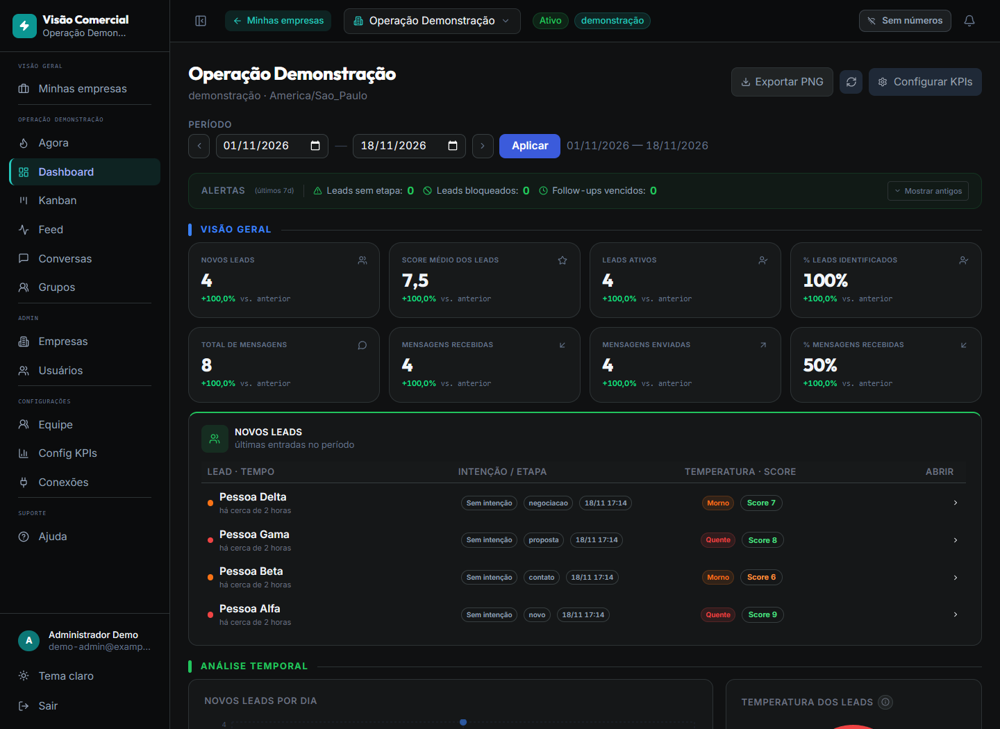
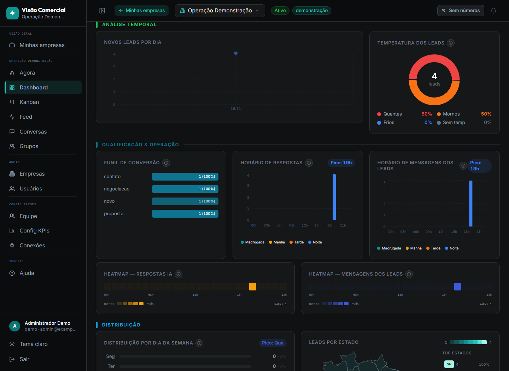
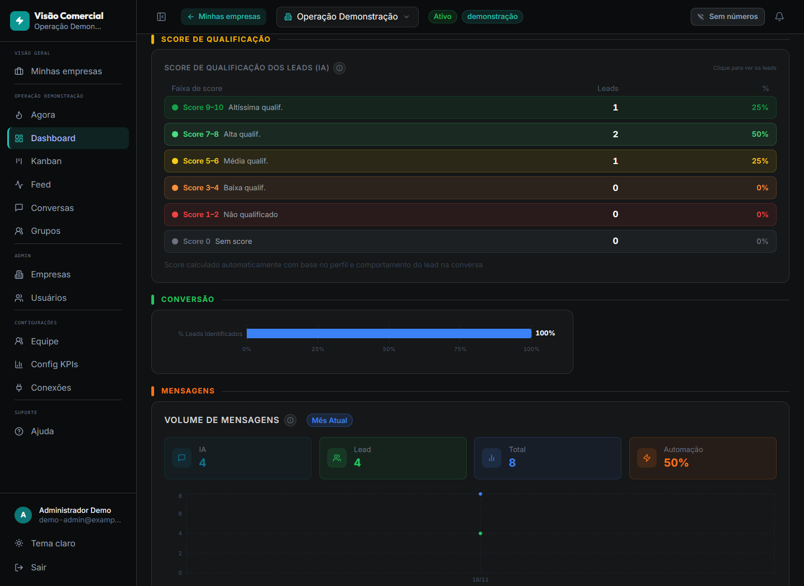

# Visão Comercial

Visão Comercial é uma prévia local de uma plataforma para acompanhamento comercial: organiza leads, centraliza conversas e oferece uma visão operacional para equipes acompanharem o funil.

> Esta versão foi preparada para demonstração local. Ela usa somente dados sintéticos. As integrações de negócio externas estão desativadas.

## Capturas da demonstração

As três telas abaixo foram capturadas na aplicação local, com quatro leads e oito mensagens fictícias. Os scores e as classificações são exemplos cadastrados; nenhuma análise externa por IA foi executada.



*Visão geral: quatro leads ativos, score médio de 7,5, 100% dos leads identificados e oito mensagens — quatro recebidas e quatro enviadas.*



*Distribuição dos leads por temperatura, etapas do funil e horários das mensagens da demonstração.*



*Detalhamento por faixa de score, percentual de identificação e volume de mensagens. Os rótulos de IA da interface representam dados simulados nesta prévia.*

## Recursos incluídos

- Autenticação local com sessão JWT e renovação de token.
- Portfólio de empresas e seleção da **Operação Demonstração**.
- Dashboard operacional com período, alertas, totais de leads e indicadores configuráveis.
- Kanban, feed, conversas, grupos e páginas de gestão de equipe/empresas.
- Configuração de KPIs pelo painel e exportação de painéis em imagem.
- Dados de demonstração com quatro leads e conversas fictícias.

A prévia não ativa análise por IA, sincronização de provedores, webhooks ou workers. Essas integrações ficam deliberadamente desativadas no ambiente local.

## Stack

- Frontend: React 18, TypeScript, Vite, Tailwind CSS, Zustand e React Query.
- API: FastAPI, SQLAlchemy, Pydantic e Alembic.
- Serviços locais: PostgreSQL, Redis, Nginx e Docker Compose.

## Requisitos

- Git para clonar o repositório.
- Docker Desktop com o engine Linux em execução e Docker Compose v2.
- PowerShell no Windows.

## Executar localmente

```powershell
git clone https://github.com/joaoguilherme23/visao-comercial.git
cd visao-comercial
powershell -ExecutionPolicy Bypass -File .\setup.ps1
docker compose up --build
```

Acesse a aplicação em [http://127.0.0.1:8310](http://127.0.0.1:8310). A API fica disponível somente em `http://127.0.0.1:8311`; PostgreSQL e Redis não expõem portas ao host.

O setup cria os segredos e a senha aleatória da demonstração local. Para entrar, use:

- Email: `demo-admin@example.com`
- Senha: consulte o arquivo local e ignorado `.demo-credentials` — nunca publique esse arquivo.

## Roteiro de uso

1. Entre com a conta de demonstração.
2. Abra **Minhas empresas** e selecione **Operação Demonstração**.
3. Use **Dashboard**, **Conversas** e **Config KPIs**.
4. O Dashboard inicia com oito KPIs de demonstração. Em **Config KPIs**, escolha os indicadores desejados e clique em **Salvar**.

O código inclui um Kanban. Na validação desta prévia, a tela permaneceu em carregamento e seu uso não foi confirmado; a causa ainda não foi determinada.

## Limites da prévia local

- Os quatro leads, nomes, telefones e conversas são sintéticos.
- Integrações externas, conexões de provedores, webhooks, IA e workers ficam desativados.
- OIDC é opcional e exige uma configuração de Central de Acesso compatível; ele não é necessário para a demonstração padrão.
- O banco local é criado para esta prévia. Não aponte o Compose para bancos existentes.

Para retomar os serviços após a primeira configuração, sem executar novamente o setup:

```powershell
docker compose up -d
```

Para encerrar os serviços:

```powershell
docker compose down
```

Para também descartar o banco local de demonstração:

```powershell
docker compose down -v
```
